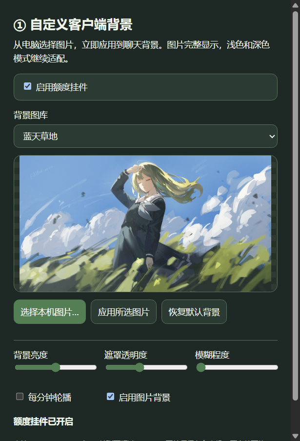
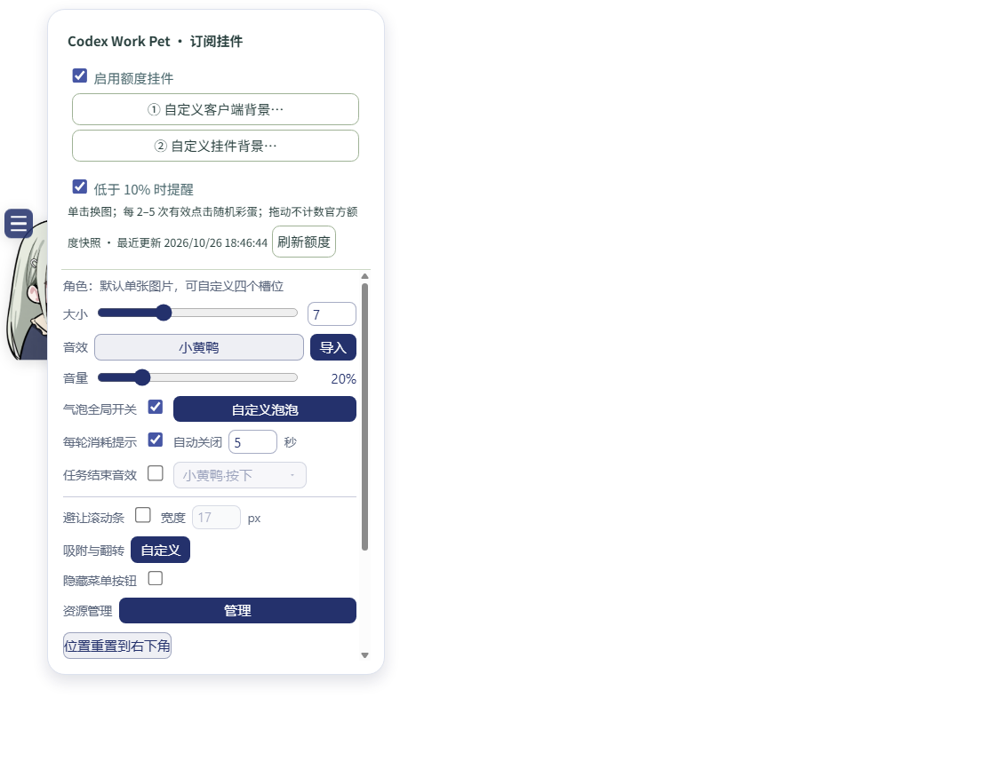

# gpt自定义插件 · codex_work_pet

当前版本：**1.1.0-beta.5**。Windows x64 上的 Codex / ChatGPT Work 背景与角色挂件组件。

**2026-11-02 背景修复：** 在客户端 `26.1023.6621.0` 上，经用户安全退出并从 Work Pet 冷启动，真实主题注入与渲染验证通过，背景已连接，角色和真实额度正常。本版修复重复普通激活，新增后台重连、离线保存壁纸和具体失败诊断。官方全部入口的无条件冷启动加载仍未实现，见 [本次背景排查记录](docs/BACKGROUND-2026-11-02.md)。

[下载完整安装包](https://github.com/xingyangmua/ChatGPT_smallpets-by-X1ngY0-and-GPT/releases/tag/v1.1.0-beta.5) · [AI 安装与接手流程](docs/AI-INSTALL.md) · [修复记录](docs/BACKGROUND-2026-11-02.md)

## AI 从这里开始

接到安装、修复或更新任务后，先读本文件、[AGENTS.md](AGENTS.md) 和 [docs/AI-INSTALL.md](docs/AI-INSTALL.md)，再检查本机。不要停在教程或准备阶段；在用户授权范围内完成安装、运行和验收。

1. **认清目标**：只支持 Windows x64、Microsoft Store 注册的 `OpenAI.Codex` 桌面包。其 GUI 进程可能叫 `ChatGPT.exe`。经典 ChatGPT、浏览器网页和 DSH 不是替代目标。
2. **找到现有安装**：检查本组件快捷方式和 `Mutsumi Codex Companion` 计划任务。已有副本时沿用它的目录，先备份；不要默认另装一份。旧版本可能保留 Mutsumi 名称，这是兼容命名。
3. **选对安装器**：源码仓库的根 `Install.ps1` 是下载器，`app/Install.ps1` 是实际安装器；完整 Release 解压后直接用根 `Install.ps1`。源码 ZIP 没有 Electron 运行时。
4. **按真实状态验收**：用安装目录里的 `Status.ps1`。进程存在不等于角色已显示，安装成功不等于额度和背景都成功。下面的状态表是验收标准。
5. **保留运行中任务**：已有窗口没有主题连接时，报告 `pending-restart`；等待安全退出后，从 **ChatGPT (Work Pet)** 管理入口冷启动。不要强杀客户端，不要把隔离截图当成实际背景接入成功。

没有用户电脑的执行权限时，只能报告完成的代码或安装包，不能声称已在本机安装。不要读取、输出或打包登录凭据、账号标识和聊天数据库；不要消费额度重置机会。

## 本版功能与修复

- 四个可自定义角色槽，默认共用唯一内置图片；单击切换、按压回弹、原点击音效、拖拽、贴边翻转、大小与位置记忆。
- 显示真实五小时和每周剩余额度、可用重置次数；不足 10% 时独立提醒，未知或过期数据不冒充有效数字。
- 彩蛋每 2–5 次有效点击随机触发，包含 `kskbl`、`zdjd`；保留计数记忆。
- 客户端背景、自选图、亮度、遮罩、模糊、轮播与浅深色适配；可选原生默认背景。
- 角色、气泡底图自定义与挂件总开关；关闭挂件会停止本组件的额度请求，设置入口仍可重新开启。
- 自动识别商店更新后的 CLI 路径；修复额度刷新循环、账号切换的旧请求回写、重复加载相同头像造成的闪烁，以及旧 PID 阻断背景恢复。

内置背景仅保留原生默认与蓝天草地 `IMG3575.jpg`；角色仅内置 `IMG3576.png`，四槽均可自行替换。私人启动动画不随公开包分发；已有单独安装的动画集成会保留。

## 安装或更新

普通用户：下载上方 Release 中的完整 Windows ZIP，解压后运行 `Install.cmd`。不要把 GitHub 自动生成的 Source code ZIP 当成完整安装包。

AI 在**源码仓库根目录**先执行预检：

```powershell
powershell.exe -NoProfile -ExecutionPolicy RemoteSigned -File .\app\Install.ps1 -PreflightOnly
```

确定现有安装目录后运行根下载器；更新已有副本时追加 `-InstallRoot "现有安装目录"`：

```powershell
powershell.exe -NoProfile -ExecutionPolicy RemoteSigned -File .\Install.ps1 -Repository xingyangmua/ChatGPT_smallpets-by-X1ngY0-and-GPT -Launch
```

根下载器按 `release.json` 下载固定版本，核对 SHA-256 后安装。完整 Release 解压目录直接运行它的 `Install.ps1 -Launch`，不再套用源码下载流程。脚本使用 Windows PowerShell 5.1；不要改用 DSH 注册命令、`curl | iex` 或绕过系统保护。

默认安装到“文档/Codex/codex_work_pet”。安装器备份已有组件代码并保留用户 `data`。桌面和开始菜单生成 **ChatGPT (Work Pet)**、**Codex Work Pet** 和 **Codex Work Pet Settings**。

## 验收标准

在**实际安装目录**运行：

```powershell
powershell.exe -NoProfile -ExecutionPolicy RemoteSigned -File .\Status.ps1
powershell.exe -NoProfile -ExecutionPolicy RemoteSigned -File .\Self-Test.ps1
```

| 状态 | 应如何判断 |
| --- | --- |
| `companionRunning=true` | 本组件已响应，不代表以下功能全部通过 |
| `widgetEnabled=true`、`widgetVisible=true`、`widgetSurfaceReady=true` | 客户端可见且挂件开启时，角色窗口已显示并具备有效绘制区域 |
| `quotaStatus=fresh`、`quotaProcessRunning=true` | 官方额度服务已连接；再核对两窗口与可用重置次数 |
| `widgetEnabled=false`、`quotaProcessRunning=false` | 用户主动关闭挂件时的正常状态 |
| `backgroundConnected=true` | 背景已在真实客户端会话中验证连接；另检查图片、正文和代码可读性 |
| `backgroundStatus=pending-restart` | 当前普通窗口未接入主题，需安全退出后从管理入口冷启动，尚未验收背景 |
| `backgroundStatus=disabled` 或原生默认背景 | 按用户的背景关闭或默认选择处理，不自动重新启用 |

当前已在注册客户端 `26.1023.6621.0` 上确认真实额度和 Work Pet 冷启动背景连接，552 项 Node 测试及 27 项隔离 Electron 交互检查通过。真实渲染检查确认主题、侧栏和输入框结构就绪；官方其他启动入口、全部换图路径、其他系统与客户端版本未据此保证兼容。

**搜索请用 `ChatGPT (Work Pet)`。** 官方 MSIX 搜索项、原固定图标或通知入口可能绕过主题启动参数；本组件没有接管所有官方入口。

挂件与真实额度由登录后常驻的伴随程序跟随客户端，和背景连接是两条独立链路。当前源码会在任何入口打开客户端后尝试重连**已经开放并验证的**背景端口；它不能给一个没有端口的普通会话补上启动参数。手动换图可在离线时保存为待应用选择，界面会明确提示等待连接，不能把“已保存”当成“已显示”。

## 使用、恢复与维护

角色右键菜单包含背景入口①、角色/气泡入口②和总开关；隐藏角色后可从设置入口或托盘恢复。

- `Set-Widget.ps1 -State Off` / `On`：关闭或开启挂件。
- `Restore-Background.ps1`：移除背景并关闭本组件背景监听。
- `Restore-Customization.cmd`：恢复示例图片与气泡。
- `Restore-PreviousVersion.ps1 -BackupDirectory "安装目录内的备份"`：恢复已保存的组件版本。
- `Uninstall.cmd`：停用本组件和自己管理的快捷方式，保留用户图片与备份。

维护者修改代码后运行 `node --test app/widget/tests/*.test.mjs`；发布流程和校验规则见 [docs/BUILD.md](docs/BUILD.md)。不要把个人 `data`、日志、截图、登录或聊天复制进源码和发布包。




上图来自隔离界面测试，数字是测试数据。详见 [使用与恢复](docs/USER-GUIDE.md)、[验证范围](docs/VERIFICATION.md) 和 [来源与许可](THIRD_PARTY_NOTICES.md)。代码许可不自动覆盖第三方角色图片或媒体。
